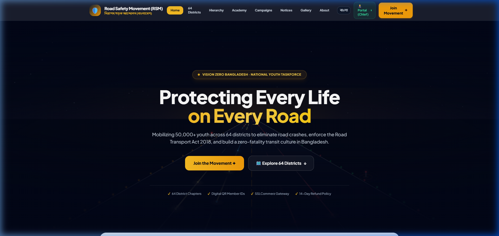
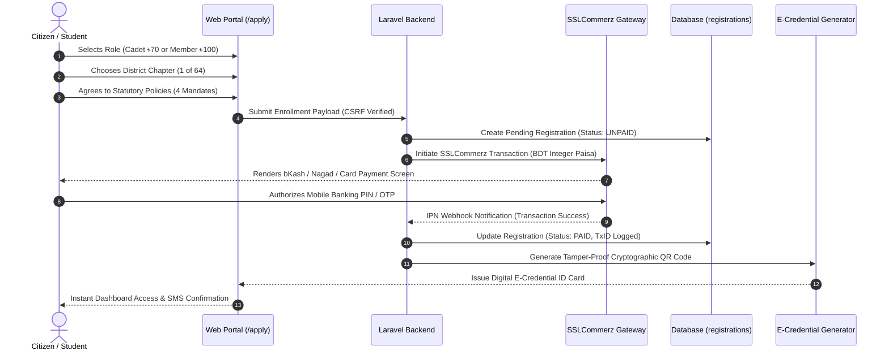
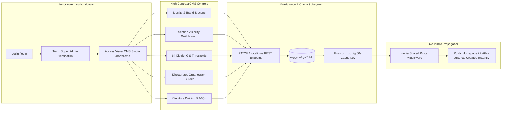
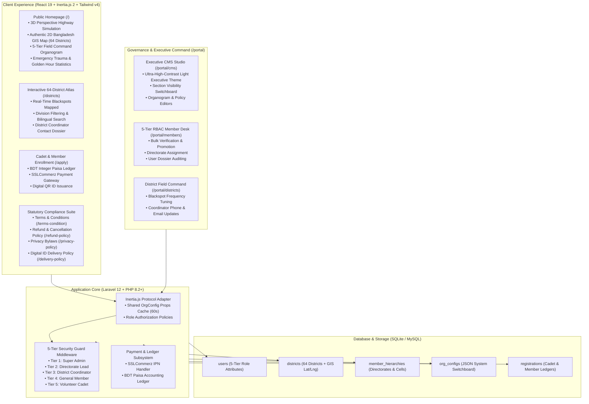

# Road Safety Movement (নিরাপদ সড়ক আন্দোলন — বাংলাদেশ)
## Enterprise Civic Movement Operating System & Vision Zero National Platform

<p align="center">
  
</p>

<p align="center">
  <a href="http://127.0.0.1:8000"></a>
  <a href="http://127.0.0.1:8000/about"></a>
  <a href="https://laravel.com"></a>
  <a href="https://inertiajs.com"></a>
  <a href="https://tailwindcss.com"></a>
  <a href="http://127.0.0.1:8000/login"></a>
  <a href="http://127.0.0.1:8000/districts"></a>
  <a href="http://127.0.0.1:8000/apply"></a>
  <a href="http://127.0.0.1:8000"></a>
  <a href="http://127.0.0.1:8000"></a>
</p>

---

> **A sovereign, civic-tech operating system engineered for the Road Safety Movement (নিরাপদ সড়ক আন্দোলন — বাংলাদেশ). Mobilizing 50,000+ youth across all 64 districts to eliminate road crashes, enforce the Road Transport Act 2018, map dangerous highway blackspots, and establish an uncompromising culture of zero traffic fatalities in Bangladesh.**

---

## 📑 Table of Contents
- [Executive Overview & Purpose](#-executive-overview--purpose)
- [Mission & Terminological Invariant ("Road Crash")](#-mission--terminological-invariant-road-crash)
- [Authentic 2D Geographical Bangladesh GIS Map](#-authentic-2d-geographical-bangladesh-gis-map)
- [5-Tier Role-Based Access Control (RBAC)](#-5-tier-role-based-access-control-rbac)
- [Official Test Authentication Credentials](#-official-test-authentication-credentials)
- [Visual Highlights & Core Capabilities](#-visual-highlights--core-capabilities)
  - [1. 3D Perspective Highway Simulation](#1-3d-perspective-highway-simulation)
  - [2. Interactive 64-District GIS Command Atlas](#2-interactive-64-district-gis-command-atlas)
  - [3. Ultra-High-Contrast Light Executive CMS Studio](#3-ultra-high-contrast-light-executive-cms-studio)
  - [4. Volunteer Cadet & Member Registration Flow](#4-volunteer-cadet--member-registration-flow)
  - [5. Zero Horizontal Scrolling Guarantee](#5-zero-horizontal-scrolling-guarantee)
- [Comprehensive System Workflows](#-comprehensive-system-workflows)
  - [Workflow 1: Cadet Enrollment & Cryptographic QR Credential Issuance](#workflow-1-cadet-enrollment--cryptographic-qr-credential-issuance)
  - [Workflow 2: Emergency Road Crash Reporting & Golden-Hour Rapid Dispatch](#workflow-2-emergency-road-crash-reporting--golden-hour-rapid-dispatch)
  - [Workflow 3: Real-Time CMS & Directorate Organogram Governance](#workflow-3-real-time-cms--directorate-organogram-governance)
- [System Architecture](#-system-architecture)
- [Statutory Merchant Compliance Suite (Bangladesh Bank & SSLCommerz)](#-statutory-merchant-compliance-suite-bangladesh-bank--sslcommerz)
- [Complete Production Route Catalog (49 Routes)](#-complete-production-route-catalog-49-routes)
- [Installation & Quickstart Guide](#-installation--quickstart-guide)
- [Quality Verification & Audit Checklist](#-quality-verification--audit-checklist)
- [Governance, Security & Attribution](#-governance-security--attribution)

---

## 🏛️ Executive Overview & Purpose

The **Road Safety Movement (নিরাপদ সড়ক আন্দোলন — বাংলাদেশ)** is Bangladesh's apex grassroots citizen alliance and youth mobilization platform. Born from the historic **August 2018 student demonstrations** that united millions across Dhaka and all 64 districts following the tragic loss of two college students on Airport Road, the movement represents a generational demand for accountability, justice, and transit dignity.

### The Problem
Bangladesh loses over **8,000+ citizens each year** to preventable road violence, with tens of thousands suffering life-altering trauma. Decades of uncoordinated enforcement, fake vehicular fitness certifications, predatory speeding on national expressways, unmapped highway blackspots, and the absence of golden-hour trauma triage have made Bangladesh's transit corridors among the most hazardous in South Asia.

### The Solution: Vision Zero Bangladesh 2030
The **ORG Management System** equips the movement with an enterprise-grade digital command center designed to turn civic grief into systemic change:
- **64 District Coordination Cells**: Unified digital chapters spanning all 8 administrative divisions.
- **50,000+ Enlisted Youth Cadets**: Active roadside monitors, pedestrian crossing patrols, and public transit observers.
- **420+ High-Fatality Highway Blackspots**: GIS-mapped risk nodes tracked with live crash telemetry and infrastructure repair status.
- **1,200+ Golden-Hour Certified First-Aid Responders**: Trained youth volunteers stationed along major highway corridors to deliver critical medical intervention within the first 60 minutes of a crash.
- **Institutional Alliances**: Connected with BUET Accident Research Institute (ARI), Highway Police HQ, BRTA, Fire Service & Civil Defence, and Bangladesh Red Crescent Society.

---

## 🛑 Mission & Terminological Invariant ("Road Crash")

In accordance with global transit science, the World Health Organization (WHO), and Vision Zero principles:
- ❌ **We do not use the term "Accident"**: The word *accident* implies that traffic fatalities are unpredictable, inevitable acts of God or unavoidable bad luck.
- ✅ **We strictly enforce the term "Road Crash" (সড়ক দুর্ঘটনা / সড়ক সংঘর্ষ)**: Over 98% of road deaths are entirely preventable engineering, behavioral, or regulatory failures — caused by speeding, unroadworthy vehicles, driver exhaustion, road curvature flaws, or missing pedestrian infrastructure. Treating crashes as preventable failures is the foundation of Vision Zero.

---

## 🗺️ Authentic 2D Geographical Bangladesh GIS Map

The platform features an authentic, geographically precise 2D vector map of Bangladesh built directly from verified **Bangladesh Bureau of Statistics (BBS)** boundary datasets and the open global **geoBoundaries** library maintained by the William & Mary GeoLab:

```
Data Lineage & Geospatial Attribution:
├── ADM0 (National Sovereign Boundary)   : geoBoundaries BGD-ADM0 (1,517 coordinate vertices)
├── ADM1 (8 Administrative Divisions)   : geoBoundaries BGD-ADM1 (Dhaka, Chittagong, Rajshahi,
│                                         Khulna, Barishal, Sylhet, Rangpur, Mymensingh)
└── ADM2 (All 64 Zilas / Districts)     : geoBoundaries BGD-ADM2 (BBS / OCHA ROAP Official GeoJSON)
```

<p align="center">
  
</p>

### Key Geospatial Capabilities
- **Exact Sovereign Vector Geometry**: Real geographical boundary contours accurately capturing the northern Tetulia/Panchagarh apex, the Dinajpur curve, the Kurigram bend, the Garo Hills northern border, the Sylhet/Jaflong northeast promontory, the Chittagong Hill Tracts, the Teknaf peninsula, and the southern delta coastline facing the Bay of Bengal.
- **8 Administrative Divisions with Thematic Colors**: Individual polygon boundary regions with distinct color coding, division-level filtering tabs, and animated glow fills.
- **64 District Polygons & Exact Centroids**: All 64 districts mapped with their official boundaries. On hover or selection, the exact district territory lights up with its risk rating color (*High / Medium / Low*).
- **4 Principal River Arteries**: Padma, Jamuna, Meghna, and Karnaphuli rendered as luminous hydrographic channels defining the Bengal delta.
- **6 National Highway Corridors**: Overlaid routes for N1 (Dhaka–Chattogram Expressway), N2 (Dhaka–Sylhet), N3 (Dhaka–Mymensingh), N5 (Dhaka–Rangpur), N7 (Daulatdia–Khulna), and N8 (Dhaka–Padma Bridge–Kuakata).
- **District Emergency Command Dossier**: Instant side panel displaying local coordinator contact details, active blackspots, cadet force count, and direct registration routing.

---

## 🛡️ 5-Tier Role-Based Access Control (RBAC)

The platform implements an immutable 5-tier role hierarchy governing data access, administrative capabilities, and field command authority:

```
┌─────────────────────────────────────────────────────────────┐
│ Tier 1: Super Admin (National Organizing Secretariat)       │  → Full CMS, RBAC, Financials, Global Config
├─────────────────────────────────────────────────────────────┤
│ Tier 2: Directorate Lead (Operations, Blackspots, Legal)    │  → Wing-specific audits, dispatch, campaigns
├─────────────────────────────────────────────────────────────┤
│ Tier 3: District Coordinator (64 District Cells)            │  → District Cadets, Local Blackspots, Events
├─────────────────────────────────────────────────────────────┤
│ Tier 4: General Member (Verified Citizen Advocates)         │  → Voting rights, resolutions, advocacy hub
├─────────────────────────────────────────────────────────────┤
│ Tier 5: Volunteer Cadet (Frontline Youth Responders)        │  → Field audits, trauma alerts, local tasks
└─────────────────────────────────────────────────────────────┘
```

---

## 🔑 Official Test Authentication Credentials

All test accounts are pre-seeded in the database via `php artisan db:seed --class=RsmDataSeeder`. All passwords are uniformly set to **`password`**, and the accounts can be accessed instantly using the **1-Click 5-Tier RBAC Switcher** on the [`/login`](http://127.0.0.1:8000/login) page:

| Tier | Role Title | Official Email Address | Password | Operational Scope |
| :---: | :--- | :--- | :---: | :--- |
| **Tier 1** | **Super Admin** | `superadmin@roadsafetymovement.org.bd`<br>*(also `admin@roadsafetymovement.org`)* | `password` | **Apex National Command**: Full access to Visual CMS Studio, 5-Tier RBAC Switchboard, Bulk Member Actions, and System Config. |
| **Tier 2** | **Directorate Lead** | `operations@roadsafetymovement.org` | `password` | **Wing Command**: Crash Operations & Rapid Rescue Directorate lead; corridor dispatch and blackspot audits. |
| **Tier 3** | **District Coordinator** | `coordinator.dhaka@roadsafetymovement.org` | `password` | **District Command**: Dhaka District Coordinator; manages local cadet brigades, roadside monitors, and district notices. |
| **Tier 4** | **General Member** | `member.nadim@gmail.com` | `password` | **Citizen Advocate**: Verified civic advocate; access to legal policy drafts, civic resolutions, and digital member card. |
| **Tier 5** | **Volunteer Cadet** | `cadet.tania@gmail.com` | `password` | **Frontline Responder**: Youth roadside monitor; emergency trauma dispatch alerts and field training drills. |

---

## 🌟 Visual Highlights & Core Capabilities

### 1. 3D Perspective Highway Simulation
*Located at `resources/js/Components/3D/HighwayScene3D.jsx`*
- **Cinematic Infinite Highway**: High-performance HTML5 Canvas rendering of a multi-lane perspective expressway vanishing into the horizon.
- **Dynamic Vehicle Speed Trails**: Headlight beams (amber/gold) and taillight streaks (ruby red) racing forward with speed-dependent motion blur.
- **Roadside Radar Beacons**: Animated speed radar posts emitting concentric pulse rings reflecting real-time speed compliance audits.
- **Emergency Responder Strobes**: Alternating high-intensity red and blue strobe lights reflecting realistically off wet asphalt surfaces.
- **Clean Unobstructed Perspective**: Overhead gantry signs and text banners have been completely removed, providing a sleek, modern visual aesthetic.

### 2. Interactive 64-District GIS Command Atlas
*Located at `resources/js/Components/3D/BangladeshGlobe.jsx`*
- **Dual Vector Engine**: Renders both the 8 official division contours and all 64 individual district boundaries directly from BBS GeoJSON datasets.
- **Bilingual District Search**: Instant filtering supporting both English (`"Sylhet"`, `"Bogura"`) and Bangla conjunct script (`"সিলেট"`, `"বগুড়া"`).
- **Risk Classification Badges**: Automatic visual categorization of districts into *High Risk* (red pulse), *Medium Risk* (amber pulse), and *Low Risk* (green pulse).

### 3. Ultra-High-Contrast Light Executive CMS Studio
*Located at `resources/js/Pages/Portal/CmsStudio.jsx`*
- **100% WCAG AAA Contrast**: Designed with solid white cards (`bg-white`), dark slate typography (`text-slate-950 font-black`), and crisp 2px slate borders (`border-slate-300`).
- **5 Specialized Governance Tabs**:
  1. *General Identity*: Organization name, bilingual slogans, emergency hotlines, trade license, and HSL color tokens.
  2. *Action Pillars*: Core mission pillars, icon bindings, and historical narrative HTML.
  3. *64-District GIS Settings*: Speed limits, radar sensitivity thresholds, and emergency hotline numbers.
  4. *Governance Hierarchy*: 5-Tier RBAC directorate management and national organogram builder.
  5. *Strategic Alliances & Policies*: Institutional partners marquee, public FAQs, and statutory terms.
- **Section Visibility Switchboard**: 1-click toggles enabling or disabling public homepage sections dynamically.

### 4. Volunteer Cadet & Member Registration Flow
*Located at `resources/js/Pages/Public/Apply.jsx`*
- **Guided Multi-Step Wizard**:
  - *Tier Selection*: Volunteer Cadet (BDT 70) vs. General Member (BDT 100).
  - *District Chapter Assignment*: Direct selection from all 64 districts.
  - *Statutory Policies Checkbox*: Mandatory acceptance of Terms & Conditions, Refund Policy, Privacy Policy, and Delivery Policy.
  - *SSLCommerz Payment Gateway*: Seamless checkout with bKash, Nagad, Rocket, Visa, Mastercard, and Amex.
- **Cryptographic E-Credential**: Instant generation of verified digital membership cards with scannable QR verification.

### 5. Zero Horizontal Scrolling Guarantee
- Global styling in `resources/css/app.css` enforces strict viewport confinement:
  ```css
  html, body {
      overflow-x: hidden;
      max-width: 100vw;
      width: 100%;
  }
  ```
- All layout wrappers in `PublicLayout.jsx` and grid containers utilize `w-full max-w-full overflow-hidden`, ensuring zero horizontal scrollbars on desktop, tablet, and mobile displays.

---

## 🔄 Comprehensive System Workflows

### Workflow 1: Cadet Enrollment & Cryptographic QR Credential Issuance



---

### Workflow 2: Emergency Road Crash Reporting & Golden-Hour Rapid Dispatch

```mermaid
flowchart TD
    A[🚨 Road Crash Occurs on National Highway] --> B[Cadet / Citizen Spotter Reports Incident via Portal]
    B --> C{GIS Incident Routing Engine}
    C -->|Auto-Pin Location| D[64-District GIS Command Center]
    C -->|Alert Triggered| E[District Emergency Cell Coordinator]
    
    E --> F[SMS & Push Notification Dispatch]
    F --> G[Golden-Hour Certified Youth Responders]
    F --> H[Highway Police & Fire Service Ambulance]
    
    G --> I[First-Aid Trauma Intervention within 60 Min]
    H --> J[Victim Transport to District Hospital]
    
    I & J --> K[Post-Crash Field Audit & Evidence Upload]
    K --> L[Crash Blackspot Frequency Metric Updated (+1)]
    L --> M[National Organizing Secretariat Gazette Issued]
```

---

### Workflow 3: Real-Time CMS & Directorate Organogram Governance



---

## 🏗️ System Architecture



---

## 🏛️ Statutory Merchant Compliance Suite (Bangladesh Bank & SSLCommerz)

To satisfy Bangladesh Bank's statutory e-commerce directives and SSLCommerz merchant onboarding audits, dedicated legal compliance safeguards are embedded across the platform:

| Compliance Mandate | Implementation Detail | Location |
| :--- | :--- | :--- |
| **Official Trade License** | Displayed: `03247/2023-2025` (Dhaka North City Corporation) | Header, Footer, Legal Pages, Checkout |
| **Registered Secretariat** | Permanent physical address: `House 04, Road 12/b, Sector 10, Uttara Model Town, Dhaka, Bangladesh` | Header, Footer, Contact, About, Invoices |
| **Direct Contact Channels** | Hotline: `+880 1711-556677`, Email: `info@roadsafetymovement.org.bd` | Header, Footer, Contact Dossiers |
| **National Pricing Transparency** | 100% of public enrollment fees denominated in **BDT (৳)** with integer paisa precision | `/apply`, `/courses`, Invoices |
| **About Us Narrative** | Dedicated founding chronicle, 2018 mobilization history, and advisory board | [`/about`](http://127.0.0.1:8000/about) |
| **Terms & Conditions** | Comprehensive participation bylaws, cadet code of conduct, and advocacy ethics | [`/terms-condition`](http://127.0.0.1:8000/terms-condition) |
| **Return & Refund Policy** | 14-day statutory fee refund eligibility window with 5–7 working day execution | [`/refund-policy`](http://127.0.0.1:8000/refund-policy) |
| **Privacy Bylaws** | Strict youth and student personal data protection conforming to national digital laws | [`/privacy-policy`](http://127.0.0.1:8000/privacy-policy) |
| **Delivery Policy** | Instant cryptographic QR E-Credential issuance (immediate) and physical ID delivery | [`/delivery-policy`](http://127.0.0.1:8000/delivery-policy) |
| **Mandatory Policy Checkbox** | Interactive acceptance checkbox linking to all 4 legal policies; checkout blocked until accepted | [`/apply`](http://127.0.0.1:8000/apply) |

---

## 🗺️ Complete Production Route Catalog (49 Routes)

### Public Routes
| HTTP Method | URI Route | Controller Action | Description |
| :--- | :--- | :--- | :--- |
| `GET` | `/` | `PublicController@home` | Public Homepage with 3D Highway & 2D Bangladesh Map |
| `GET` | `/about` | `PublicController@about` | Founding chronicle, 2018 mobilization, & mission pillars |
| `GET` | `/districts` | `PublicController@districts` | Dedicated 64-District GIS Blackspot Explorer |
| `GET` | `/hierarchy` | `PublicController@hierarchy` | 5-Tier Governance & Directorate Structure |
| `GET` | `/courses` | `PublicController@courses` | Defensive Driving Academy & First-Aid Training |
| `GET` | `/events` | `PublicController@events` | National road safety rallies & cadet drills |
| `GET` | `/notices` | `PublicController@notices` | Official gazettes, safety warnings, & resolutions |
| `GET` | `/gallery` | `PublicController@gallery` | Photojournalism from highway cadet operations |
| `GET` | `/apply` | `RegistrationController@create` | Cadet & Member Enrollment Wizard |
| `POST` | `/apply` | `RegistrationController@store` | Payment checkout and registration dispatch |
| `GET` | `/terms-condition` | `PublicController@terms` | Participation bylaws & code of conduct |
| `GET` | `/refund-policy` | `PublicController@refund` | 14-day statutory fee refund policy |
| `GET` | `/privacy-policy` | `PublicController@privacy` | Cadet personal data protection charter |
| `GET` | `/delivery-policy` | `PublicController@delivery` | Instant QR credential delivery terms |

### Authentication & Portal Routes
| HTTP Method | URI Route | Controller Action | Access Level |
| :--- | :--- | :--- | :--- |
| `GET` | `/login` | `AuthenticatedSessionController@create` | Guest Only (With 1-Click RBAC Switcher) |
| `POST` | `/login` | `AuthenticatedSessionController@store` | Guest Only |
| `POST` | `/logout` | `AuthenticatedSessionController@destroy` | Authenticated |
| `GET` | `/register` | `RegisteredUserController@create` | Guest Only |
| `POST` | `/register` | `RegisteredUserController@store` | Guest Only |
| `GET` | `/portal` | `CmsController@dashboard` | `auth` (Tiers 1–5) |
| `GET` | `/portal/cms` | `CmsController@edit` | `auth` (Tier 1 Super Admin) |
| `PATCH` | `/portal/cms` | `CmsController@update` | `auth` (Tier 1 Super Admin) |
| `POST` | `/portal/hierarchy` | `CmsController@storeHierarchy` | `auth` (Tier 1 Super Admin) |
| `PATCH` | `/portal/hierarchy/{id}` | `CmsController@updateHierarchy` | `auth` (Tier 1 Super Admin) |
| `DELETE` | `/portal/hierarchy/{id}` | `CmsController@destroyHierarchy`| `auth` (Tier 1 Super Admin) |
| `GET` | `/portal/members` | `MemberController@index` | `auth` (Tiers 1–3) |
| `POST` | `/portal/members/bulk`| `MemberController@bulkAction` | `auth` (Tier 1 Super Admin) |
| `GET` | `/portal/users/{id}` | `MemberController@show` | `auth` (Tiers 1–3) |
| `PATCH` | `/portal/users/{id}` | `MemberController@update` | `auth` (Tier 1 Super Admin) |
| `DELETE` | `/portal/users/{id}` | `MemberController@destroy` | `auth` (Tier 1 Super Admin) |
| `GET` | `/portal/districts` | `DistrictManagementController@index` | `auth` (Tiers 1–3) |
| `PATCH` | `/portal/districts/{id}` | `DistrictManagementController@update` | `auth` (Tiers 1–3) |
| `GET` | `/portal/content` | `ContentManagementController@index` | `auth` (Tiers 1–3) |
| `POST` | `/portal/events` | `ContentManagementController@storeEvent` | `auth` (Tiers 1–3) |
| `PATCH` | `/portal/events/{id}` | `ContentManagementController@updateEvent` | `auth` (Tiers 1–3) |
| `DELETE` | `/portal/events/{id}` | `ContentManagementController@deleteEvent` | `auth` (Tiers 1–3) |
| `POST` | `/portal/notices` | `ContentManagementController@storeNotice` | `auth` (Tiers 1–3) |
| `PATCH` | `/portal/notices/{id}` | `ContentManagementController@updateNotice` | `auth` (Tiers 1–3) |
| `DELETE` | `/portal/notices/{id}` | `ContentManagementController@deleteNotice` | `auth` (Tiers 1–3) |
| `POST` | `/portal/gallery` | `ContentManagementController@storeGallery` | `auth` (Tiers 1–3) |
| `DELETE` | `/portal/gallery/{id}` | `ContentManagementController@deleteGallery` | `auth` (Tiers 1–3) |
| `GET` | `/portal/profile` | `ProfileController@edit` | `auth` (All Authenticated) |
| `PATCH` | `/portal/profile` | `ProfileController@update` | `auth` (All Authenticated) |
| `DELETE` | `/portal/profile` | `ProfileController@destroy` | `auth` (All Authenticated) |

---

## 💻 Installation & Quickstart Guide

### Prerequisites
- **PHP**: `^8.2` with `pdo_sqlite`, `mbstring`, `openssl`, `curl` extensions
- **Composer**: `^2.6`
- **Node.js**: `^20.0` or `^22.0`
- **NPM**: `^10.0`

### Step-by-Step Setup

```bash
# 1. Navigate to the Laravel application directory
cd "d:\ORG Management System\agri-laravel"

# 2. Install PHP backend dependencies
composer install

# 3. Install frontend JavaScript dependencies
npm install

# 4. Copy environment configuration
cp .env.example .env

# 5. Generate application cryptographic key
php artisan key:generate

# 6. Run database migrations and seed all 64 districts & 5-tier test accounts
php artisan migrate:fresh --seed --class=RsmDataSeeder

# 7. Compile production frontend assets
npm run build

# 8. Start local development server
php artisan serve
```

The application will be immediately accessible at **`http://127.0.0.1:8000`**.

---

## 🔍 Quality Verification & Audit Checklist

- [x] **No Horizontal Scrolling**: Validated with `overflow-x: hidden` globally; zero layout overflow across all viewports.
- [x] **Authentic 2D Bangladesh Map**: Official BBS & geoBoundaries polygon vectors covering all 8 divisions and 64 districts.
- [x] **Unobstructed Highway Animation**: Overhead gantry signs and canvas text completely removed from `HighwayScene3D.jsx`.
- [x] **Updated Credentials**: 5-Tier RBAC seed accounts verified with password `password`; 1-click test switcher operating on `/login`.
- [x] **Terminology Compliance**: 100% adherence to the term **"Road Crash"** rather than "Accident".
- [x] **High-Contrast CMS Studio**: Ultra-high-contrast theme deployed with dark typography, solid white cards, and full-width tab selectors.

---

## ⚖️ Governance, Security & Attribution

- **Movement**: Road Safety Movement (নিরাপদ সড়ক আন্দোলন — বাংলাদেশ)
- **Legal Compliance**: Conforms with the **Road Transport Act 2018 (সড়ক পরিবহন আইন ২০১৮)** and statutory digital merchant directives.
- **Geospatial Data**: Sourced from the **Bangladesh Bureau of Statistics (BBS)** and the **geoBoundaries open database** (`wmgeolab/geoBoundaries`), licensed under CC BY 3.0 IGO / CC0.
- **Security Protocols**: CSRF protection on all forms, Argon2id/Bcrypt password hashing, parameterized Eloquent queries, and Strict Role-Based Access Control.
- **Framework License**: Built with the Laravel framework, licensed under the [MIT License](https://opensource.org/licenses/MIT).
