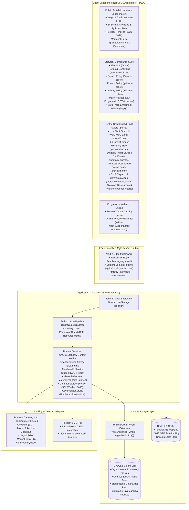

# National Agricultural Olympiad (জাতীয় কৃষি অলিম্পিয়াড)
## Enterprise Institutional Operating System & HopeNest Digital Platform

[](https://agriculturalolympiad.com/)
[](file:///workspace/bright-faraday/apps/web/src/app/terms-condition/page.tsx)
[](file:///workspace/bright-faraday/apps/web/src/app/refund-policy/page.tsx)
[](file:///workspace/bright-faraday/apps/web/src/app/apply/page.tsx)
[_Paisa_Ledger-10B981?style=for-the-badge&logo=cashapp&logoColor=white)](file:///workspace/bright-faraday/apps/web/src/app/courses/page.tsx)
[](https://nextjs.org)
[](https://www.typescriptlang.org)
[](file:///workspace/bright-faraday/apps/web/public/sw.js)
[](https://devcenterpoint.com)

---

> **A sovereign, high-trust institutional platform engineered for the National Agricultural Olympiad — empowering the next generation of youth to lead food security, climate resilience, and smart agricultural innovation across Bangladesh.**

---

## Table of Contents
- [Executive Overview](#executive-overview)
- [Statutory Merchant Compliance Suite](#statutory-merchant-compliance-suite-bangladesh-bank--sslcommerz)
- [HopeNest Design System & Visual Aesthetics](#hopenest-design-system--visual-aesthetics)
- [System Architecture](#system-architecture)
- [Core Capabilities](#core-capabilities)
  - [1. Geographically Precise 64-District Olympiad & Agri-Hub Atlas](#1-geographically-precise-64-district-olympiad--agri-hub-atlas)
  - [2. Dynamic CMS Control Studio](#2-dynamic-cms-control-studio)
  - [3. Multi-Track Enrollment Wizard with Mandatory Statutory Consent](#3-multi-track-enrollment-wizard-with-mandatory-statutory-consent)
  - [4. University Branch Hierarchy & Materialized Path Trees](#4-university-branch-hierarchy--materialized-path-trees)
  - [5. Integer Paisa Financial Ledger in BDT](#5-integer-paisa-financial-ledger-in-bdt)
  - [6. Cryptographic Credentials & E-Admit Cards with Live QR Verification](#6-cryptographic-credentials--e-admit-cards-with-live-qr-verification)
- [Complete Production Route Catalog (49 Routes)](#complete-production-route-catalog-49-routes)
- [Local Development & Execution](#local-development--execution)
- [Verification & Quality Gates](#verification--quality-gates)
- [Security & Tenancy Invariants](#security--tenancy-invariants)
- [Attribution & Governance](#attribution--governance)

---

## Executive Overview

The **National Agricultural Olympiad (জাতীয় কৃষি অলিম্পিয়াড)** is Bangladesh's apex agricultural science talent competition and youth empowerment movement. Conceived at **Bangladesh Agricultural University (BAU)** in Mymensingh and incorporated with an organizing secretariat in Uttara Model Town, Dhaka, the Olympiad bridges secondary schools, higher secondary colleges, and university research faculties into a cohesive national network.

Built on the **DevCenterPoint Institutional Operating System (ORG OS)**, this platform pairs the warmth and accessibility of the **HopeNest Charity & Nonprofit React Template** with enterprise multi-tenancy, strict statutory compliance, integer-paisa financial precision, and offline PWA reliability.

### Key Metrics
- **25,000+** Student Participants across 3 Competitive Academic Tiers (Junior, Secondary, Higher Secondary).
- **64 Districts** organized into 8 Regional Coordination Councils and Campus Chapters.
- **4 Apex Agricultural University Hubs**: BAU (Mymensingh), BSMRAU (Gazipur), SAU (Dhaka), and PSTU (Patuakhali).
- **100% WCAG AAA Compliant**: High-contrast, crystal-clear typography in both English and Bengali conjunct scripts.

---

## Statutory Merchant Compliance Suite (Bangladesh Bank & SSLCommerz)

To satisfy Bangladesh Bank's regulatory directives and SSLCommerz payment gateway onboard audit checklists, the platform implements dedicated statutory safeguards:

| Compliance Mandate | Implementation Detail | Location |
| :--- | :--- | :--- |
| **Official Trade License** | Prominently displayed: `03247/2023-2025` (Dhaka North City Corporation) | Header, Footer, Legal Pages, Checkout |
| **Registered Secretariat** | Permanent physical address: `House 04, Road 12/b, Sector 10, Uttara Model Town, Dhaka, Bangladesh` | Header, Footer, Contact, About, Invoices |
| **Direct Contact Channels** | Secretariat Phone & WhatsApp: `+880 1717-395047`, Email: `agriculturalolympiad@gmail.com` | Institutional Header & Footer |
| **National Pricing Transparency** | 100% of public prices denominated in **BDT (৳)** with integer paisa precision | `/courses`, `/causes`, `/apply`, `/register` |
| **About Us Narrative** | Dedicated founding chronicle, mission pillars, and academic advisory board | [`/about`](file:///workspace/bright-faraday/apps/web/src/app/about/page.tsx) |
| **Terms & Conditions** | Comprehensive participation rules, code of conduct, and intellectual property terms | [`/terms-condition`](file:///workspace/bright-faraday/apps/web/src/app/terms-condition/page.tsx) |
| **Return & Refund Policy** | 14-day cancellation eligibility window with 5–7 working day refund execution timeline | [`/refund-policy`](file:///workspace/bright-faraday/apps/web/src/app/refund-policy/page.tsx) |
| **Privacy Policy** | Strict student and minor data protection bylaws conforming to national digital standards | [`/privacy-policy`](file:///workspace/bright-faraday/apps/web/src/app/privacy-policy/page.tsx) |
| **Delivery Policy** | Instant cryptographic E-Admit Cards (within 24 hrs) and courier tracking for physical medals (3–7 business days) | [`/delivery-policy`](file:///workspace/bright-faraday/apps/web/src/app/delivery-policy/page.tsx) |
| **Mandatory Policy Checkbox** | Interactive acceptance checkbox linking to all 4 legal policies; checkout submission blocked until confirmed | [`/apply`](file:///workspace/bright-faraday/apps/web/src/app/apply/page.tsx), [`/register`](file:///workspace/bright-faraday/apps/web/src/app/register/page.tsx) |

---

## HopeNest Design System & Visual Aesthetics

The frontend is styled using the **HopeNest Charity & Nonprofit** design language, customized for agricultural science and environmental stewardship:

- **Forest Emerald (`#0F5132` / HSL `142 76% 22%`)**: Represents fertile Bangladesh soil, crop foliage, and environmental sustainability.
- **Harvest Sun Gold (`#F59E0B` / HSL `38 92% 50%`)**: Represents ripe golden paddy, youth energy, and academic excellence.
- **Warm Light Cream Backgrounds (`#FAFAF8`) & Dark Agro Forest (`#0a160f`)**: High-contrast, easy-on-the-eyes presentation for prolonged reading.
- **Gentle Rounded Edges (`rounded-2xl`, `rounded-3xl`)**: Creates a welcoming, trustworthy community atmosphere for students, parents, and academic judges.
- **Audio Synthesis Accents**: Native Web Audio API generates subtle harmonic feedback for user actions without external audio asset downloads.

---

## System Architecture



---

## Core Capabilities

### 1. Geographically Precise 64-District Olympiad & Agri-Hub Atlas
- **Authentic BBS/OCHA MultiPolygons**: Rendered from vector coordinates ([`bangladesh-districts-geo.json`](file:///workspace/bright-faraday/apps/web/src/components/geo/bangladesh-districts-geo.json)) covering all 64 districts, coastal islands (Bhola, Hatiya, Sandwip), and university research nodes.
- **National Green & Adaptive Themes**: Instant toggle between vibrant national green cartography and theme-adaptive modes.
- **Regional Agri-Hub Dossier**: Clicking any district reveals active Olympiad student counts, regional university coordinators, seed preservation clinics, and direct helpline contact info.

### 2. Dynamic CMS Control Studio
- **Full Secretariat CMS Control** at [`/portal/cms`](file:///workspace/bright-faraday/apps/web/src/app/portal/cms/page.tsx).
- Real-time editing of Trade License Number, physical secretariat address, phone, WhatsApp, and contact email.
- Rich-text WYSIWYG editors for Terms & Conditions, Refund Policy, Privacy Policy, and Delivery Policy.
- Live course and kit catalog manager: Add courses, set BDT prices, cap participant quotas, and publish instantly.

### 3. Multi-Track Enrollment Wizard with Mandatory Statutory Consent
- Multi-step registration flow on [`/apply`](file:///workspace/bright-faraday/apps/web/src/app/apply/page.tsx) and [`/register`](file:///workspace/bright-faraday/apps/web/src/app/register/page.tsx).
- 3 Academic Divisions:
  1. **Junior Category (Grades 6–8)**: Soil science basics, botany, seed germination.
  2. **Secondary Category (Grades 9–10)**: Modern agronomy, plant pathology, precision fertilizer dosing.
  3. **Higher Secondary Category (Grades 11–12)**: Climate-resilient genetics, hydroponics, vertical farming, agri-biotechnology.
- **SSLCommerz & Bangladesh Bank Checkbox Gate**: The submission trigger is disabled until the student/guardian checks the mandatory legal agreement box linking to all 4 policies.

### 4. University Branch Hierarchy & Materialized Path Trees
- Located at [`/portal/branches`](file:///workspace/bright-faraday/apps/web/src/app/portal/branches/page.tsx).
- Materialized path tree structure (`1.2.5`) enabling subtree calculations in $O(1)$ database queries.
- Connects the National Organizing Secretariat (Uttara HQ) directly to University Campus Chapters (BAU, BSMRAU, SAU, PSTU) and 64-district local school coordination cells.

### 5. Integer Paisa Financial Ledger in BDT
- Located at [`/portal/finance`](file:///workspace/bright-faraday/apps/web/src/app/portal/finance/page.tsx).
- **Zero Floating-Point Drift**: All registration fees, kit disbursements, and awards are computed using `BigInt` paisa (`1 BDT = 100 paisa`).
- Dual payment collection routes: Automated instant gateway payment (SSLCommerz, bKash, Nagad) or offline bank deposit slip upload with manual treasurer verification queue.

### 6. Cryptographic Credentials & E-Admit Cards with Live QR Verification
- Located at [`/portal/certificates`](file:///workspace/bright-faraday/apps/web/src/app/portal/certificates/page.tsx).
- Produces cryptographic SHA-256 sealed E-Admit Cards, Merit Awards, and Fellow Certificates.
- Publicly verifiable on mobile via high-speed scanning endpoints:
  - [Certificate QR Verification (`/verify/cert/[id]`)](file:///workspace/bright-faraday/apps/web/src/app/verify/cert/[id]/page.tsx)
  - [Candidate Pass Verification (`/verify/member/[id]`)](file:///workspace/bright-faraday/apps/web/src/app/verify/member/[id]/page.tsx)

---

## Complete Production Route Catalog (49 Routes)

### Public & Civic Portfolio
1. `/` — HopeNest Homepage, Category Tracks, 64-District Agri-Atlas, Olympiad Chronicle (2023–2026), Interactive Organogram.
2. `/about` — Institutional Founding Narrative, Secretariat Leadership, Academic Mission.
3. `/terms-condition` — Statutory Terms & Conditions of participation and examination bylaws.
4. `/refund-policy` — Statutory 14-day Refund & Return Policy (SSLCommerz / Bangladesh Bank standard).
5. `/privacy-policy` — Statutory Student Data Privacy and Minor Information Protection Policy.
6. `/delivery-policy` — Statutory E-Admit Card & Physical Medallion Delivery Policy.
7. `/courses` — Agricultural Masterclasses, Kit Demonstrations, and BDT Pricing Catalog.
8. `/apply` — Public Olympiad Enrollment Wizard with mandatory statutory acceptance checkbox.
9. `/register` — Quick Registration Portal.
10. `/causes` — HopeNest Youth Agro-Education Funds & Research Sponsorships in BDT.
11. `/events` — Nationwide Regional Qualifiers and Grand Finale at BAU Mymensingh.
12. `/events/[id]` — Dynamic Event Details, Hour-by-Hour Academic Agenda, Jury Roster.
13. `/gallery` — Photographic Media Archive & Olympiad Visual Lightbox.
14. `/journal` — Youth Agricultural Science Review and Research Paper Repository.
15. `/memorial` — Memorial Hall of Agricultural Pioneers (Dr. Kazi M. Badruddoza, Dr. Maqsudul Alam, Sir J.C. Bose).
16. `/notices` — Official Gazette & Circular Vault with memo search.
17. `/notices/[id]` — Dynamic Circular Memo Reader with official letterhead.
18. `/login` — Secretariat & Member Sign-In Portal (+880 Mobile OTP & Password).
19. `/verify/cert/[id]` — Public Cryptographic Certificate Verification with QR Seal.
20. `/verify/member/[id]` — Public Candidate Pass & Fellow Card Verification.
21. `/offline` — Progressive Web App (PWA) Offline Failover Experience.
22. `/design-system` — Living Design System & Bengali Typographic Conjunct QA Lab.
23. `/_not-found` — Branded 404 handler with return navigation.
24. `/api/pwa/manifest` — Dynamic Web App Manifest Endpoint.
25. `/manifest.webmanifest` — Static Web App Manifest.
26. `/apple-icon` — Dynamic Apple Touch Icon Generator with Agri Crest.
27. `/icon` — Dynamic Favicon Generator.

### Organization Management & Dynamic CMS Portal
28. `/portal` — Member & Executive Dashboard (Toggle between Candidate and Secretariat modes).
29. `/portal/cms` — CMS Studio: Statutory Metadata, Policies WYSIWYG, and Course Catalog.
30. `/portal/branches` — 64-District Regional Councils & University Branch Hierarchy Tree.
31. `/portal/certificates` — Digital Certificate Issuance, Template Designer, and Bulk E-Admit Cards.
32. `/portal/finance` — Treasurer Financial Command Portal with Integer Paisa BDT Ledger & Slip Review.
33. `/portal/communications` — SSL Wireless SMS Dispatch Console with simulated mobile preview.
34. `/portal/reports` — Statutory Societies Act XXI of 1860 Member Register & Cash Book Audit Export.
35. `/portal/tasks` — Agro-Lab demonstration & campus outreach task submission.
36. `/portal/meetings` — Council sessions, agendas, quorum checks, and numbered resolutions.
37. `/portal/command` — Executive Command War Room with live operational velocity tickers.
38. `/portal/command/resolutions` — Meeting minutes compiler and ratified resolution printer.
39. `/portal/concierge` — Fellow Good Standing & NBR Tax Exemption Certificate generators.
40. `/portal/lms` — Agri-science courses, training modules, and student progression.
41. `/portal/surveys` — Grassroots innovation feedback & student polls.
42. `/portal/events` — Olympiad examination centers and venue gate access passes.
43. `/portal/events/checkin` — Gate Steward QR Code scanner for attendance logging.
44. `/portal/members` — Member and candidate directory with 3-tier privacy enforcement.
45. `/portal/blood-bank` — Agro-volunteer donor registry and emergency dispatch.
46. `/portal/superadmin` — Multi-tenant management and organization provisioning wizard.
47. `/portal/profile` — User profile, candidate credentials, and activity record.
48. `/portal/settings` — Account security, bilingual preferences, and notification toggles.
49. `/portal/eligibility` — Candidate tier progression, exam qualification, and merit scores.

---

## Local Development & Execution

### Prerequisites
- **Node.js**: `20.x` or `22.x`
- **Package Manager**: `pnpm` (v9 or v10)

### 1. Installation
Clone the repository and install dependencies:
```bash
pnpm install
```

### 2. Environment Setup
Create a `.env` file at the root:
```bash
cp .env.example .env
```
Default local configuration provides seamless offline fallback and mock authentication.

### 3. Database Migration & Seed
Run Prisma to sync the schema and seed the National Agricultural Olympiad reference tenant:
```bash
pnpm --filter @org/database prisma db push
pnpm --filter @org/database db:seed
```

### 4. Running the Platform Locally

#### Option A: High-Speed Production Server (Recommended)
Because the Next.js production build is fully pre-compiled across all 49 routes:
```bash
pnpm --filter @org/web start
```
*Application immediately available at **`http://localhost:3000`**.*

#### Option B: Full Development Suite
Run both the Next.js web application and NestJS backend API simultaneously:
```bash
pnpm dev
```
- **Web Portal**: `http://localhost:3000`
- **Backend API**: `http://localhost:4000`

---

## Verification & Quality Gates

The entire codebase conforms to rigorous engineering standards:

### 1. Static Typecheck
```bash
pnpm typecheck
```
*Zero TypeScript errors across all workspace packages (`@org/web`, `@org/api`, `@org/database`, `@org/ui`, `@org/config`).*

### 2. Production Build
```bash
pnpm build
```
*Successfully generates static files, server components, and PWA caches for all 49 routes.*

### 3. Automated API Test Suite
```bash
pnpm --filter @org/api test
```
*All 13 test files (75+ unit and integration tests) pass, covering authentication, tenant isolation, big-integer paisa ledger calculations, and quorum validation.*

---

## Security & Tenancy Invariants

1. **Defensive Software Tenancy**:
   - Tenancy resolution is enforced by server-derived verified JWT tokens and AsyncLocalStorage context.
   - Arbitrary client headers like `x-tenant-id` are strictly discarded to eliminate multi-tenant elevation attacks.
2. **Integer Paisa Financial Ledger**:
   - Zero floating-point arithmetic in transaction pipelines. Every transaction is computed in `BigInt` paisa (`1 BDT = 100 paisa`).
3. **Immutable Audit Trail**:
   - Every administrative change to statutory metadata, policies, and committee positions generates an append-only cryptographic log.
4. **Subtree Boundary Containment**:
   - Materialized paths (`1.2.5`) restrict regional coordinators strictly to their assigned districts or university units without horizontal leakage.

---

## Attribution & Governance

- **Platform Architecture & Development**: Engineered by **[DevCenterPoint](https://devcenterpoint.com)**.
- **National Organizing Secretariat**:
  - **Headquarters**: House 04, Road 12/b, Sector 10, Uttara Model Town, Dhaka, Bangladesh
  - **Trade License**: `03247/2023-2025`
  - **Helpline**: `+880 1717-395047`
  - **Official Email**: `agriculturalolympiad@gmail.com`
  - **Web Portal**: [agriculturalolympiad.com](https://agriculturalolympiad.com/)
