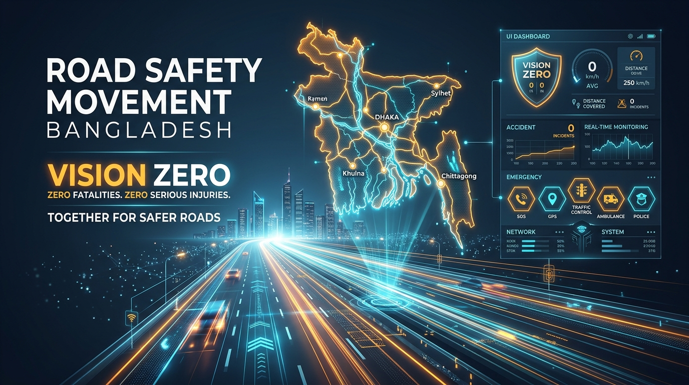

# Road Safety Movement (নিরাপদ সড়ক আন্দোলন — বাংলাদেশ)
## Enterprise Civic Movement Operating System & Vision Zero National Platform

<p align="center">
  
</p>

Please refer to the comprehensive root documentation for full architecture, diagrams, workflows, and route catalogs:
👉 **[Root Project Documentation (README.md)](../README.md)**

---

### Official Test Authentication Credentials (5-Tier RBAC)
All test accounts are pre-configured with the default password: **`password`**

| Tier | Role Title | Official Email Address | Operational Scope |
| :---: | :--- | :--- | :--- |
| **Tier 1** | **Super Admin** | `superadmin@roadsafetymovement.org.bd`<br>*(also `admin@roadsafetymovement.org`)* | **Apex National Command**: Full access to Visual CMS Studio, 5-Tier RBAC Switchboard, Bulk Member Actions, and System Config. |
| **Tier 2** | **Directorate Lead** | `operations@roadsafetymovement.org` | **Wing Command**: Crash Operations & Rapid Rescue Directorate lead; corridor dispatch & blackspot audits. |
| **Tier 3** | **District Coordinator** | `coordinator.dhaka@roadsafetymovement.org` | **District Command**: Dhaka District Coordinator; field cadet management, local blackspots, and notices. |
| **Tier 4** | **General Member** | `member.nadim@gmail.com` | **Citizen Advocate**: Verified civic advocate; policy voting, resolutions, and digital member ID. |
| **Tier 5** | **Volunteer Cadet** | `cadet.tania@gmail.com` | **Frontline Responder**: Youth roadside monitor; emergency trauma dispatch alerts and field training drills. |

---

### Quick Setup Commands
```bash
composer install
npm install
php artisan migrate:fresh --seed --class=RsmDataSeeder
npm run build
php artisan serve
```

Access the application at **`http://127.0.0.1:8000`**.
